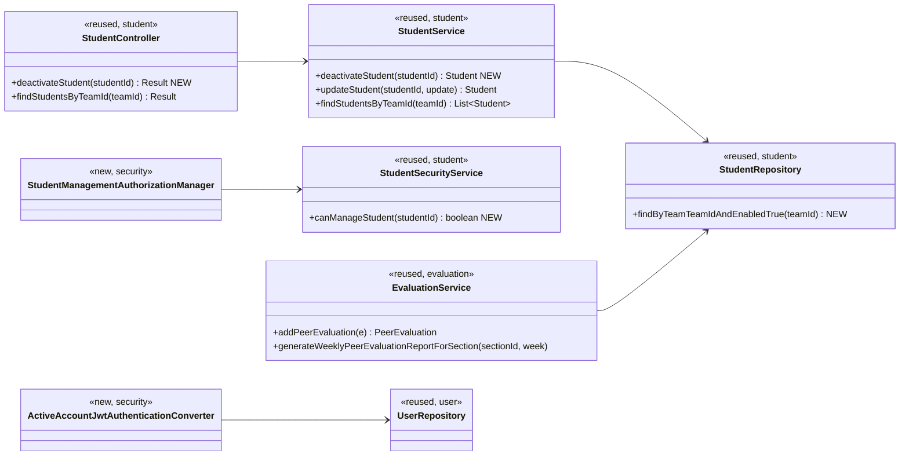
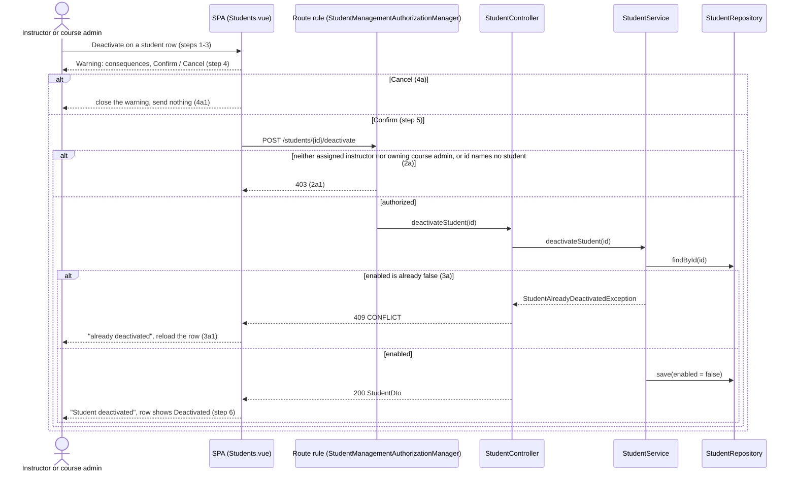

# Student (STU) Design

> Realizes: UC-STU-deactivate-student
> Depends on: FR-SEC-active-account, BR-student-lifecycle, BR-submission-owed, BR-section-scoped-access, BR-role-based-access
> See: [use cases](../requirements/use-cases.md#student), [SRS non-use-case FRs](../requirements/software-requirements-specification.md), [architectural-design.md](architectural-design.md) (foundation component view, Authorization)
> Designed against `main` at `59f0267` (2026-11-03). This is design-as-built: the student slice, `PeerEvaluationUser.enabled`, and login denial already exist.

## Overview

A student is deactivated by clearing `enabled` on her account; her team membership, activities, and peer evaluations stay. Before this design that happened only as a side effect of `PUT /students/{id}` (the Edit dialog's Status switch), with no warning, no "already deactivated" check, no path for an owning course admin, and a token that stayed valid for up to two hours. This area now owns the deactivation transition as its own endpoint, and enforces its consequences where they matter: the account check on every request (FR-SEC-active-account) and the peer-evaluation paths (BR-submission-owed). It adds no package and no table; it extends `student`, `security`, and `evaluation` in the REST API container.

## Components & classes



- **Backend, new:** `StudentController.deactivateStudent`, `StudentService.deactivateStudent`, `StudentSecurityService.canManageStudent`, `security/authorizationmanagers/StudentManagementAuthorizationManager`, `security/ActiveAccountJwtAuthenticationConverter`, and one route rule in `SecurityConfiguration` placed before the `denyAll()` catch-all.
- **Backend, changed:** `StudentService.updateStudent` stops copying `enabled`; `findStudentsByTeamId` returns active students only; `EvaluationService.generateWeeklyPeerEvaluationReportForSection` filters `isEnabled()`; `EvaluationService.addPeerEvaluation` refuses a deactivated evaluator or evaluatee.
- **Reused unchanged:** `MyUserPrincipal.isEnabled` (login denial), `SubmissionStatusService` (already excludes deactivated students), `StudentDto`, `Result`, `StatusCode.CONFLICT`.
- **Frontend:** `pages/students/Students.vue` gains a Deactivate button per row (hidden when she is already deactivated) that opens an `ElMessageBox.confirm`; `EditStudentForm.vue`'s Status switch becomes a read-only tag; `apis/student` gains `deactivateStudent`. UI text says *Active* and *Deactivated*, not Enabled and Disabled.

## Sequence

### UC-STU-deactivate-student: the main scenario and its extensions



### FR-SEC-active-account: a token issued before deactivation

```mermaid
sequenceDiagram
    participant S as Deactivated student (old JWT)
    participant F as Bearer token filter
    participant C as ActiveAccountJwtAuthenticationConverter
    participant UR as UserRepository
    S->>F: any protected request
    F->>C: convert(jwt)
    C->>UR: load the user by the id claim
    UR-->>C: enabled = false
    C-->>S: 401; the SPA clears the token and goes to login
```

## API contract

| Endpoint or job | Caller (who may) | Request | Success | Errors, by extension |
|---|---|---|---|---|
| `POST /api/v1/students/{studentId}/deactivate` | An instructor assigned to the student's course section, or the course admin who owns its course (BR-section-scoped-access, BR-role-based-access): `StudentManagementAuthorizationManager` | Path id only, no body | `200` `Result` carrying the `StudentDto` with `enabled: false` | 2a: `403`, also for an id that names no student (the route rule fails closed). 3a: `409` `CONFLICT`, message "This student is already deactivated." 4a: no request is sent |
| `PUT /api/v1/students/{studentId}` | Unchanged | Unchanged | Unchanged | Behavior change: `enabled` in the body is ignored; name, username, and email still apply |
| `GET /api/v1/students/teams/{teamId}` | Unchanged | Unchanged | Lists active students only | None new |
| Peer evaluation submit (existing route) | Unchanged | Unchanged | Unchanged | `400` through the existing `PeerEvaluationIllegalArgumentException` when the evaluator or the evaluatee is deactivated |
| Any protected route | Any bearer token | | | `401` when the token's user is deactivated (FR-SEC-active-account) |

## Key decisions

**A dedicated deactivate endpoint, and `PUT` ignores `enabled`.** The transition needs a warning, a 3a check, and its own authorization, none of which a field on a general update can carry. Rejected: keep deactivating through `PUT`, which leaves an unguarded second path that skips 3a and lets a rename and a deactivation travel in one request. Rejected: `PATCH {enabled: false}`, the same toggle under another name, which UC-STU-reactivate-student would then have to share. Accepted consequence: until UC-STU-reactivate-student is built, nothing in the UI re-activates a student.

**A verb sub-resource, not `DELETE`.** `DELETE /students/{id}` is the physical delete of UC-STU-delete-student. Reusing it would blur the two operations the use case sets apart.

**3a is `409`, not `400` and not an idempotent `200`.** The request is well-formed; the state conflicts. An idempotent `200` would hide the "already deactivated" notice 3a requires.

**Who may call it: assigned instructor or owning course admin, one new manager.** Rejected: `userOwnershipAuthorizationManager`, which admits `isCurrentUserInstructorOfStudentSection || isStudentSelf`. It denies an owning course admin who is not assigned to the section, which BR-section-scoped-access allows, and it would let a student deactivate herself. The same composition decision is recorded in [not.md](not.md#key-decisions) (*Authorization*).

**The account check runs on every request, not only at login.** The converter loads the user by the id claim and rejects a disabled one, a primary-key lookup per request. Rejected: a shorter token lifetime, which still leaves a window the FR forbids. Rejected: a denylist of tokens, which adds state to store and expire for a rare event. It also covers deactivated instructors with no further work. Cost: one read per request, acceptable at course scale (see Open questions).

**The consequences are enforced on the server, not only hidden in the UI.** The teammate list and the section report filter on `enabled`, and `addPeerEvaluation` refuses a deactivated party. Rejected: hiding her in the UI only, since a crafted request would then record an evaluation that BR-submission-owed says nobody owes.

**She stays on her team and is not told.** The use case specifies neither a team removal nor a notice to the student (reactivation notifies; deactivation does not). Rejected: removing her from the team, which would force a re-assignment on reactivation and lose her place.

## Data model

No delta. `enabled` is an existing column on `PeerEvaluationUser` (baseline migration), so there is no new column, index, or Flyway file. The area reads `Student`, `Team`, and `Section` as the SRS's [Business Domain Model](../requirements/software-requirements-specification.md#business-domain-model) defines them.

## Reuse & cross-cutting

- Login denial: `MyUserPrincipal.isEnabled` already makes Spring Security refuse a valid password for a disabled account; the new converter closes the remaining gap for tokens issued earlier.
- Who owes what: `SubmissionStatusService` already applies BR-submission-owed (`student.isEnabled()`), so reminders and the status lists need no change.
- Authorization: the two-point model in [Authorization](architectural-design.md#authorization): the route rule above, and a service that loads the student by the id the rule verified.
- Error envelope: a new `StudentAlreadyDeactivatedException` (in `student/`) is mapped to `409` / `StatusCode.CONFLICT` in `ExceptionHandlerAdvice`, beside `SectionLockRequiredException`; there is no generic conflict exception to reuse.

## Tests

| Use case, flow | Level | Asserts |
|---|---|---|
| UC-STU-deactivate-student main | integration | An assigned instructor's `POST …/deactivate` returns `200` with `enabled: false`; the student is still on her team and her activities and peer evaluations remain |
| UC-STU-deactivate-student main, course admin | integration | The course admin who owns the course but is not assigned to the section gets `200` |
| UC-STU-deactivate-student 2a | integration | An instructor of another course section, a course admin of another course, the student herself, and an unauthenticated caller get `403`; an id that names no student gets `403`; nothing is deactivated |
| UC-STU-deactivate-student 3a | unit and integration | A second call returns `409` and the state is unchanged; the service throws `StudentAlreadyDeactivatedException` |
| UC-STU-deactivate-student 4a | E2E (Cypress, API stubbed) | Cancelling the warning sends no request and leaves the row unchanged |
| UC-STU-deactivate-student step 4 | E2E (Cypress, API stubbed) | The warning names the loss of login and of weekly activity report and peer evaluation submission, and that her work is kept |
| `PUT` ignores `enabled` | integration | A `PUT` with `enabled: false` leaves the flag true, and an edited name or email is saved |
| FR-SEC-active-account, login | integration | A deactivated student cannot log in with valid credentials |
| FR-SEC-active-account, live token | integration | A token issued before deactivation gets `401` on a protected route afterward |
| Teammate list | integration | `GET /students/teams/{teamId}` omits the deactivated student |
| Section report | integration | The weekly peer evaluation report for the course section omits her; evaluations she gave other students still exist |
| Peer evaluation submit | unit | A deactivated evaluatee, and a deactivated evaluator, are refused |
| BR-submission-owed | existing | `SubmissionStatusServiceTest` already asserts a deactivated student is never listed; re-run, no new test |

## Open questions / risks

- **Reactivation gap.** Between this use case and UC-STU-reactivate-student there is no UI path to reactivate a student. Build reactivate straight after, or release them together.
- **One lookup per request.** The converter adds a primary-key read to every authenticated request. Fine at about 80 students; revisit against the SRS performance attributes if load grows.
- **Platform-tier delta, not yet in the architecture-of-record.** The per-request account check adds a step to the [Authorization](architectural-design.md#authorization) chain, a platform-tier section both modules inherit. It is recorded here and flagged for separate confirmation, not folded into that section by this design.
- **Her received scores leave the section report.** The use case says she will not show up; the evaluations others gave her are kept but unlisted. If instructors need her history, that is a separate decision.
- **Caller authorities in `StudentService`.** Removing the instructor check around `enabled` in `updateStudent` reduces, but does not clear, OI-63 (the service still reads `SecurityContextHolder`).
